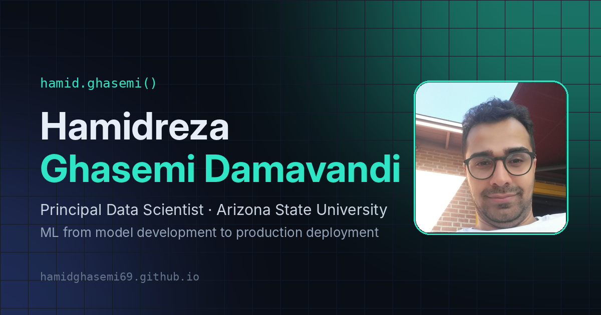

<div align="center">

# 🌐 hamidghasemi69.github.io

**Source of my personal website: a fast, single-page portfolio hosted on GitHub Pages**

<p>
  
  
  
  
  
</p>

</div>

---

<p align="center">
  <a href="https://hamidghasemi69.github.io"><b>🔗 Visit the live site</b></a>
</p>

<p align="center">
  
</p>

## ✨ Features

- **Custom single-page design** in hand-written HTML, CSS and JavaScript, with no front-end framework
- **Dark and light themes** with a toggle that remembers the visitor's choice
- **Animated background** of flowing wave lines (canvas), an intro loading screen, scroll progress bar and reveal-on-scroll animations
- **Respects accessibility settings**: animations are turned off for visitors who prefer reduced motion
- **Sections:** About, Research Interests, Experience, Projects, Skills, Talks, Certifications, Updates, Visa Status, My Journey (animated map), Travel, For Recruiters (FAQ) and Contact
- **Contact tools:** Calendly booking button, one-click copy email, QR code, downloadable contact card (vCard) and a share button
- **Contact form** that delivers messages by email through [FormSubmit](https://formsubmit.co/)
- **Privacy-friendly analytics** with [GoatCounter](https://www.goatcounter.com/) (no cookies)
- **Rich link previews** (Open Graph card) when the site is shared on LinkedIn, Slack or iMessage
- **Fully responsive**, from phones to wide screens

## 📂 Structure

```
├── index.html          # the homepage (custom single-page design)
├── _pages/about.md     # classic page from the original template (/about-classic/)
├── _config.yml         # Jekyll site settings
├── images/             # profile photo, logos, travel photos, favicon, link-preview card
├── files/resume.pdf    # downloadable résumé
├── _includes/ _layouts/ _sass/   # template files used by the classic pages
└── README.md
```

## 🚀 Run locally

```bash
git clone https://github.com/hamidghasemi69/hamidghasemi69.github.io.git
cd hamidghasemi69.github.io

bundle install
bundle exec jekyll serve      # → http://localhost:4000
```

Pushing to `master` publishes the site automatically with GitHub Pages.

## 🙏 Credits

Originally based on the [Academic Pages](https://github.com/academicpages/academicpages.github.io) template, itself derived from [Minimal Mistakes](https://github.com/mmistakes/minimal-mistakes) by Michael Rose, released under the MIT License (see [LICENSE](LICENSE)). The homepage has since been fully redesigned.

## 👤 Author

**Hamidreza Ghasemi** · Principal Data Scientist @ Arizona State University

[](https://hamidghasemi69.github.io)
[](https://www.linkedin.com/in/hamidghasemi69/)
[](https://github.com/hamidghasemi69)

<sub>If you find this project useful, consider giving it a ⭐</sub>
